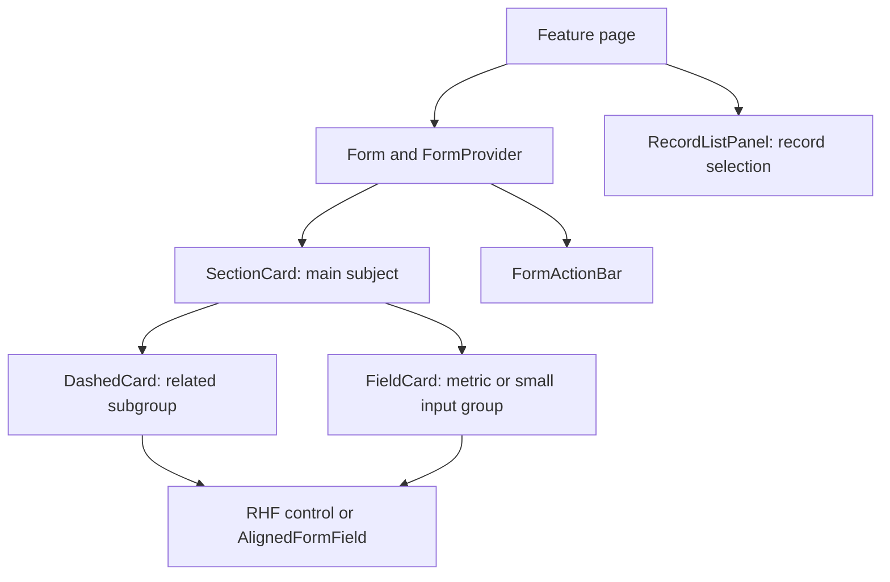

# UI Implementation and Shared Component Guide

[فارسی](ui-component-guide.fa.md) | English

Audience: developers and agents building new features or changing existing UI.

Code reviewed on: 2026-09-29. This document describes the current redesigned components and recommended development conventions. It covers shared form, card, and record-selection UI; it is not an exhaustive catalog of domain components.

## 1. Where to start

1. Identify the page type: form, report, list, or record selector.
2. Read the selection table and open the closest production example.
3. Import shared components from `#src/shared/ui/...`. Do not import another feature's files solely to reuse generic presentation.
4. Keep API calls, data mapping, validation, and service-specific tone selection inside the feature.
5. Before delivery, check both code and desktop/mobile rendering.

**Reading this guide:** “Current behavior” describes the implementation today. Selection rules and checklists are recommended team conventions for new development; not all are enforced by lint rules.

## 2. Component selection

| Need | Choose | Usage rule |
| --- | --- | --- |
| Main form section with a title and actions | `SectionCard` | A distinct subject, such as basic information or service details |
| Short, essential main section | `SectionCard collapsible={false}` | Keep required inputs visible |
| Long section or optional details | `SectionCard` with an appropriate initial state | Reduce page length after checking unmount behavior |
| Related subgroup within a section | `DashedCard` | A dashed visual boundary for nested content |
| Value, amount, metric, or small titled input group | `FieldCard` | Plain title or tone tag with vertically stacked content |
| Custom surface that already owns its container and padding | `DashedBorder` | Decorative outline only; it supplies no container or layout |
| External label aligned with a control | `AlignedFormField` | Label/control layout, independent of form value registration |
| Sidebar list with one selected record | `RecordListPanel` | Controlled accordion with loading, error, and empty states |
| Submit, back, and other form actions | `FormActionBar` | Shared action layout; submit logic belongs to the feature |
| Input connected to React Hook Form | The `rhf-pro` family | Form value, validation, and error integration |
| Data table | Existing `BasicTable` in `src/components/basic-table` | Inspect its API and a nearby feature's list implementation first |

### Recommended hierarchy



This is a schematic, not a product screenshot. Not every page needs every layer: do not nest cards just to display a single input. Avoid multiple levels of accordion unless the domain requires them, as with an addendum tree.

## 3. When to use an accordion

| Situation | Recommended decision |
| --- | --- |
| Essential initial information, primary filters, or a blocking error | Always visible; `collapsible={false}` |
| Long section that users frequently edit | Collapsible, initially expanded |
| Optional details, advanced settings, or rarely used information | Collapsible; initially closed if appropriate for the workflow |
| Several records with one selected at a time | `RecordListPanel` |
| A small group with two inputs | Static `FieldCard` or `DashedCard`; no accordion needed |
| Parent-controlled state or coordinated panels | The current `SectionCard` API is not externally controlled; use controlled `Collapse` with feature-owned logic |

`SectionCard` is an independent panel. Opening one does not close others. It is not a substitute for `Collapse accordion` when selection must be exclusive.

**Closing unmounts content:** `SectionCard` removes its children from the React tree when closed. Child state, uploaders, editors, and effects may initialize again when reopened. React Hook Form value retention depends on the location of `FormProvider` and settings such as `shouldUnregister`. Test sections containing unsaved edits, or keep them non-collapsible. The current API has no “hidden but mounted” mode.

## 4. Component API reference

### SectionCard

Sources: [implementation](../src/shared/ui/section-card/index.tsx), [CSS](../src/shared/ui/section-card/styles.css).

```tsx
import { SectionCard } from "#src/shared/ui/section-card";

<>
	<SectionCard title="Basic information" collapsible={false} tone="primary">
		{/* Inputs */}
	</SectionCard>

	<SectionCard title="Additional details" defaultExpanded={false}>
		{/* Optional information */}
	</SectionCard>
</>;
```

| Prop | Current behavior |
| --- | --- |
| `title`, `children` | Required `ReactNode` values |
| `collapsible` | Defaults to `true`; explicitly pass `false` for a fixed section |
| `defaultExpanded` | Defaults to `true`; initializes state only, does not control it after mounting |
| `extra` | Header actions next to the expand/collapse button |
| `tone` | Defaults to `primary`; an inherited context value takes precedence |
| `className` | Feature-specific scope for limited overrides |

The outer card is outlined and has a decorative header line; its entire perimeter is not dashed. The API does not currently expose `style`, `onToggle`, or `expanded`. Prefer text titles: the button's accessible name uses `String(title)`, so complex JSX can produce an unsuitable name. The button currently has an `aria-label` but no `aria-expanded` or `aria-controls`; a successful build does not resolve this accessibility limitation.

### DashedCard and FieldCard

Sources: [implementation](../src/shared/ui/dashed-card/index.tsx), [CSS](../src/shared/ui/dashed-card/styles.css).

```tsx
import { DashedCard, FieldCard } from "#src/shared/ui/dashed-card";

<>
	<DashedCard title="Company shares" extra={<span>3 companies</span>}>
		{/* Related controls */}
	</DashedCard>

	<FieldCard title="Monthly revenue" tone="gold">
		{/* Amount control and unit */}
		<p className="dashed-card__hint">Enter the amount in rials.</p>
	</FieldCard>
</>;
```

- `children` is required. `title`, `extra`, `tone`, and `className` are optional.
- `DashedCard` defaults to `variant="default"` and `collapsible={false}`. A title without a tone uses `strong`.
- `FieldCard` is the `variant="field"` specialization: a lighter plain title, stacked content, and input-oriented spacing. Providing a tone renders the title as a Tag.
- `FieldCard` does not accept `variant`, `collapsible`, or `defaultExpanded`. Use `extra` for header actions; the old `headerExtra` name is invalid.
- `DashedCard collapsible` renders a **SectionCard**. There is no `.dashed-card__content` or `.dashed-card__header` in that mode; fixed dashed-card overrides will not apply.
- For new features that need an accordion section from the outset, using `SectionCard` directly is clearer.
- `style` and arbitrary HTML props are not forwarded to the root. Only declared props are supported.

**Structural boundary:** the old Performance wrapper used AntD Card; the current `FieldCard` uses a `section`. Do not depend on `.ant-card-body`. This structural change still requires visual verification.

### DashedBorder

Source: [implementation](../src/shared/ui/dashed-border/index.tsx).

Use it when a custom container does not fit `DashedCard`, for example a report surface with specialized layout. `DashedCard` and `FieldCard` already render their own outline; do not add a second border inside them.

```tsx
import { DashedBorder } from "#src/shared/ui/dashed-border";

<div className="example-report-surface">
	<DashedBorder radius={28} dashLength={6} dashGap={6} />
	{/* Custom surface content */}
</div>;
```

```css
.example-report-surface {
  position: relative;
  border-radius: 28px;
  padding: 24px;
}
```

These numbers only demonstrate matching radii. Use theme tokens in a real feature. The parent needs `position: relative` or another appropriate containing block. The SVG is absolutely positioned, full-size, `z-index: 3`, `pointer-events: none`, and `aria-hidden`. The parent must obtain its dimensions from content.

Optional numeric props: `radius`, `dashLength`, and `dashGap`. Defaults are `paddingLG + borderRadiusSM`, `sizeXS - lineWidthBold`, and `paddingXXS`, respectively. Color and stroke width come from `colorSplit` and `lineWidth`. Changing the parent's radius alone does not update the SVG; keep the radii aligned. A dashed outline indicates grouping, not an error or selected state.

### AlignedFormField and useAlignedLabelWidth

Source: [implementation](../src/shared/ui/aligned-form-field/index.tsx).

- `label: string` and `children` are required. `labelId` and `align="center" | "start"` are optional.
- The wrapper supplies layout only; it does not manage values, validation, or submission.
- The hook measures the widest label. Apply its returned style to the common parent of that group and pass translated labels.
- Use `align="start"` for textareas and tall controls.
- The label is a `div`, not an HTML `label`. Connect the control through `aria-labelledby` and `labelId`, or provide another accessible name.
- When using an external label, clear the RHF input's internal label to avoid duplication while preserving its accessible name.

### form-layout and grids

Source: [shared CSS](../src/shared/ui/form-layout/styles.css).

```tsx
import "#src/shared/ui/form-layout/styles.css";
```

| Class | Purpose and behavior |
| --- | --- |
| `form-layout` | Places form labels above controls; also overrides `AlignedFormField` to use a vertical layout |
| `aligned-form-grid` | Base grid with shared spacing |
| `aligned-form-grid--two` | Two columns; one at widths of 768px and below |
| `aligned-form-grid--four` | Four columns; two at 1200px and below, one at 768px and below |
| `aligned-form-date-grid` | Date-group label/control layout; remains vertical inside `form-layout` |

`aligned-form-grid--three` is not defined in the shared CSS. Its presence in a consumer does not make it a supported shared API. For three columns, define a feature-scoped class with explicit breakpoints. Cards do not provide the page's grid or responsive layout on their own.

### FormActionBar

Source: [implementation](../src/shared/ui/form-action-bar/index.tsx).

`primaryActions` is required; `secondaryActions` and `className` are optional. Put the primary submit action and secondary actions in their respective slots. This component is not sticky and does not manage loading, permissions, or submission. Inside a `<form>`, submit buttons need `htmlType="submit"`; other actions need `htmlType="button"`.

### RecordListPanel

Source: [implementation](../src/shared/ui/record-list-panel/index.tsx).

Use it to select contracts or predictions, not as a generic form accordion. Required props: `title`, `items` matching `CollapseProps["items"]`, `onSelect`, `errorMessage`, and `emptyDescription`. Optional props: `activeKey`, `loading`, `error`, and `unavailableDescription`.

State display priority: unavailable → loading → error → empty → items. The parent supplies `activeKey`. `onSelect` fires only for a nonempty key; closing an item does not emit a deselection callback. If deselection is needed, extend the API deliberately.

### RHF inputs and foundational components

Import inputs from the [RHF family barrel](../src/shared/ui/rhf-pro/index.ts):

| Data/control type | Existing component |
| --- | --- |
| Text / multiline text | `RHFProText` / `RHFProTextArea` |
| Numbers and amounts | `RHFProNumber`; configure grouping and units to match the data model |
| List selection | `RHFSelect` |
| Small choice set | `RHFSegmentedSwitch` or `RHFProRadioGroup` |
| Boolean | `RHFProCheckbox` |
| Date | `RHFProDate` |
| Numeric slider | `RHFProSlider` |
| File | `RHFProUploadButton` |
| Multiple text values | `RHFFieldArrayText` |

An `RHFProDateRange` file exists but is not exported from the current barrel. A file's existence does not guarantee a ready public API. Read its props and value conversions before using it. Controls receive `control` through a prop or `FormProvider`. UI wrappers do not replace validation or permission checks.

Older components in [src/components](../src/components/index.ts) remain part of the project: `BasicContent` for page framing, `BasicTable` for tables, and access-control, scrollbar, page-error, and application providers. Do not recreate them just to standardize folder paths. New generic presentation belongs in `shared/ui`; migrating all of `src/components` is separate work.

## 5. Adaptable example for a new form

This example runs inside the application's usual providers and theme. The feature owns the save callback. Static text is for readability; use translations in production.

```tsx
import { AlignedFormField } from "#src/shared/ui/aligned-form-field";
import { FieldCard } from "#src/shared/ui/dashed-card";
import { FormActionBar } from "#src/shared/ui/form-action-bar";
import { RHFProText } from "#src/shared/ui/rhf-pro";
import { SectionCard } from "#src/shared/ui/section-card";
import { Button } from "antd";
import { useId } from "react";
import { FormProvider, useForm } from "react-hook-form";
import "#src/shared/ui/form-layout/styles.css";

interface Values { title: string }

export function ExampleFeatureForm({
	onSave,
}: {
	onSave: (values: Values) => Promise<void>
}) {
	const methods = useForm<Values>({ defaultValues: { title: "" } });
	const titleId = useId();

	return (
		<FormProvider {...methods}>
			<form
				className="form-layout grid gap-4"
				onSubmit={methods.handleSubmit(onSave)}
			>
				<SectionCard title="Basic information" collapsible={false}>
					<div className="aligned-form-grid aligned-form-grid--two">
						<AlignedFormField label="Title" labelId={titleId}>
							<RHFProText<Values, "title">
								name="title"
								label=""
								inputProps={{ "aria-labelledby": titleId }}
							/>
						</AlignedFormField>
						<FieldCard title="Help">
							<p className="dashed-card__hint">Enter a recognizable title.</p>
						</FieldCard>
					</div>
				</SectionCard>
				<FormActionBar
					primaryActions={(
						<Button type="primary" htmlType="submit" loading={methods.formState.isSubmitting}>
							Save
						</Button>
					)}
				/>
			</form>
		</FormProvider>
	);
}
```

Add the feature's schema/rules for real validation. Handle save errors and success feedback in the handler or feature layer. This example is intentionally not a complete business form.

## 6. Tone, CSS, and dependencies

`SectionTone` supports only `primary`, `purple`, `gold`, `blue`, `geekblue`, `traffic`, and `addenda`. Colors come from [section-tone.ts](../src/shared/ui/section-card/section-tone.ts); `purple` and `addenda` currently use fixed colors. Service/operator-based tone selection belongs in the feature. Do not interpret a tone as success/error without a domain convention.

`SectionToneContext.Provider` must be supplied explicitly; `SectionCard` does not establish a new provider itself. `SectionCard` prefers context over its own tone prop, while static `DashedCard`/`FieldCard` title tags use only their own tone prop. Pass their tone explicitly when they must match.

CSS rules:

- Each primitive owns its adjacent stylesheet and loads it through the component import. Import the layout stylesheet explicitly when using only its classes.
- Keep feature CSS in the feature and scope selectors to its class, for example `.invoice-metrics .dashed-card__header`.
- Avoid global overrides of `.ant-card`, `.ant-tag`, or `.dashed-card` for one page's needs.
- Use existing theme tokens and logical properties such as `padding-inline` for spacing and color. Check RTL and supported themes.
- Do not arbitrarily convert camelCase AntD variable names to kebab-case or vice versa. Both patterns occur in this project; verify the actual variable in the theme/computed styles.
- Shared class names are now generic, but `--contract-section-*` and `--contract-form-label-width` CSS variables remain part of the current contract. Do not rename them in a single feature alone.
- `shared/ui` must not import feature-specific APIs or models. Features may compose primitives and supply data.

## 7. Production examples and migration status

| Pattern | Reference |
| --- | --- |
| FieldCard for multiple metrics | [Performance PSP fields](../src/features/performance/shared/services/psp/psp.fields.tsx) |
| Card header action | [Performance traffic fields](../src/features/performance/shared/services/traffic/traffic.fields.tsx) |
| Static and collapsible subgroups | [Prediction OpenAPI fields](../src/features/prediction/shared/services/openapi/openapi.fields.tsx) |
| Custom metric card with tone | [Performance details](../src/features/performance/list/ui/components/PerformanceDetailModal.tsx) |
| Controlled Collapse inside a dashed surface | [Contract addenda](../src/features/contract/components/addenda/ContractAddendaSection.tsx) |
| Sidebar record selection | [Company contracts](../src/features/contract/list/ui/components/CompanyContractsPanel.tsx) |
| Form action bar | [Prediction actions](../src/features/prediction/shared/ui/form/sections/ActionSection.tsx) |

These examples demonstrate UI composition. Do not copy their business conditions or models into a new feature.

The old names/paths `ContractFormSection`, `ContractDashedBorder`, `ContractAlignedField`, `PerformanceFieldCard`, and `PredictionDashedCard` have been removed. Their replacements are `SectionCard`, `DashedBorder`, `AlignedFormField`, `FieldCard`, and `DashedCard`, respectively. The old label-width hook has been replaced by `useAlignedLabelWidth`.

Not every card in the project has been unified. For example, `ContractTypeSection` retains an AntD Card structure and pricing-specific requirements. It does not need to be forced into `DashedCard`. Extract additional duplication only when behavior and layout are compatible.

## 8. Developer and agent checklist

Before changing code:

- [ ] Read the selected primitive's API, CSS, and one real consumer.
- [ ] Use `rg` to find consumers and overrides for any class you will change.
- [ ] Decide whether the section is fixed/collapsible, how state survives, and where required fields appear.
- [ ] Confirm the public API accepts the intended props; do not assume `style` or `headerExtra` exists.

Before delivery:

- [ ] Implement the feature's required loading, error, empty, disabled, and permission states.
- [ ] Check accessible input/button names, Tab order, and keyboard expansion/collapse.
- [ ] Check long Persian labels, numbers, currency units, RTL, and supported themes.
- [ ] Check 390px, 768px, 1200px, and 1440px widths for overflow and duplicate dashed outlines.
- [ ] Confirm collapse does not lose edits, files, or required state; validation errors in closed sections must be discoverable.
- [ ] Do not introduce old imports, copied shared CSS, or presentation dependencies on another feature.
- [ ] Run checks appropriate to the change and report pre-existing errors separately from new errors.

```sh
pnpm typecheck
pnpm exec eslint <changed-ts-and-tsx-files>
pnpm exec vitest run
pnpm build
git diff --check
```

`<changed-ts-and-tsx-files>` is a placeholder; supply actual paths. For documentation-only changes, verify links and examples rather than rerunning the entire suite. For UI changes, successful builds and tests do not replace visual verification.

## 9. Verification status

The last card-extraction check passed 42 tests across 16 files, the production build, and lint without errors on checked files. Existing feature warnings remained. Typecheck reported the known `editor` prop error in `TemplateCreateSidebar.tsx`. This is a historical result; check again for subsequent deliveries.

To inspect component appearance and behavior, open the production examples listed in section 7 in the application. Before/after visual parity has not been verified.

## 10. Short handoff instruction for the next agent

> Before developing UI, read `docs/ui-component-guide.en.md` and the relevant component source. Use SectionCard for a main subject, DashedCard for a subgroup, FieldCard for a metric or small input group, and DashedBorder only for a custom container. Decide collapse and state retention deliberately. Do not copy generic API or CSS from another feature. Keep domain logic inside features. When changing a selector, inspect every override. Report test/build results separately from visual verification, and update this document when the API changes.
