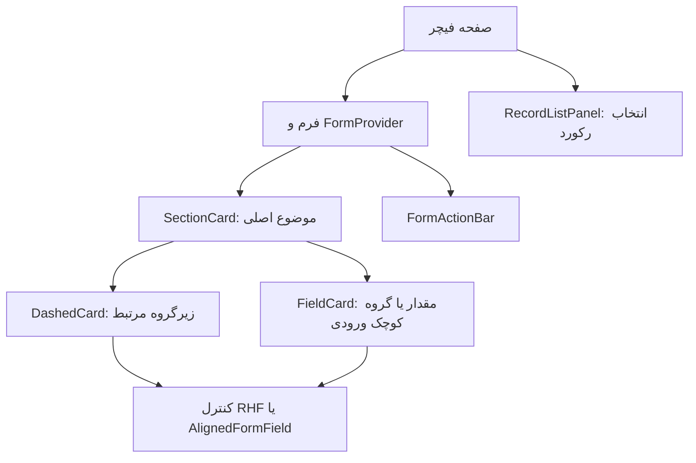

# راهنمای پیاده‌سازی UI و استفاده از کامپوننت‌های مشترک

فارسی | [English](ui-component-guide.en.md)

مخاطب: توسعه‌دهنده و ایجنتی که فیچر جدید می‌سازد یا UI موجود را تغییر می‌دهد.

تاریخ بررسی کد: ۲۰۲۶-۰۹-۲۹. این سند رفتار فعلی کامپوننت‌های ری‌دیزاین را مستند می‌کند و قواعد پیشنهادی توسعه را مشخص می‌کند. دامنه آن لایه UI مشترک فرم‌ها، کارت‌ها و انتخاب رکورد است؛ کاتالوگ کامل تمام کامپوننت‌های دامنه‌ای پروژه نیست.

## ۱. از کجا شروع کنیم؟

1. نوع صفحه را تعیین کنید: فرم، گزارش، فهرست یا انتخاب رکورد.
2. جدول انتخاب زیر را بخوانید و نزدیک‌ترین نمونه واقعی را باز کنید.
3. کامپوننت عمومی را از `#src/shared/ui/...` وارد کنید؛ فایل feature دیگر را برای ظاهر عمومی import نکنید.
4. منطق API، تبدیل داده، validation و انتخاب رنگ بر اساس نوع سرویس را در feature نگه دارید.
5. پیش از تحویل، هم بررسی کد و هم بررسی نمای دسکتاپ/موبایل را انجام دهید.

**تفاوت مهم:** بخش‌های «رفتار فعلی» توصیف پیاده‌سازی امروز هستند. قواعد انتخاب و چک‌لیست‌ها قرارداد پیشنهادی تیم برای توسعه جدیدند؛ همه آن‌ها با lint enforce نمی‌شوند.

## ۲. جدول انتخاب کامپوننت

| نیاز | انتخاب | دلیل و قاعده استفاده |
| --- | --- | --- |
| بخش اصلی فرم با عنوان و action | `SectionCard` | مرز یک موضوع مستقل، مثل اطلاعات پایه یا اطلاعات سرویس |
| بخش اصلی کوتاه و ضروری | `SectionCard collapsible={false}` | فیلدهای ضروری همیشه دیده شوند |
| بخش طولانی یا جزئیات اختیاری | `SectionCard` با حالت باز/بسته مناسب | کاهش طول صفحه، پس از بررسی اثر unmount |
| زیرگروه مرتبط داخل یک بخش | `DashedCard` | مرز بصری خط‌چین برای محتوای nested |
| مقدار، مبلغ، metric یا گروه کوچک ورودی با عنوان | `FieldCard` | عنوان ساده یا tag رنگی و محتوای عمودی |
| سطح سفارشی که خودش container و padding دارد | `DashedBorder` | فقط تزئین خط‌چین؛ wrapper یا layout ایجاد نمی‌کند |
| label بیرونی و کنترل هم‌تراز | `AlignedFormField` | کنترل چیدمان label و input، مستقل از ثبت مقدار فرم |
| لیست رکورد با انتخاب یک مورد در sidebar | `RecordListPanel` | accordion کنترل‌شده با loading/error/empty |
| دکمه‌های ثبت، بازگشت و عملیات فرم | `FormActionBar` | چیدمان مشترک عملیات؛ منطق submit متعلق به feature است |
| ورودی متصل به React Hook Form | خانواده `rhf-pro` | اتصال value، validation و پیام خطا به فرم |
| جدول داده | `BasicTable` موجود در `src/components/basic-table` | ابتدا API و نمونه فهرست همان feature را بررسی کنید |

### سلسله‌مراتب پیشنهادی



این نمودار شماتیک است، اسکرین‌شات محصول نیست. لازم نیست همه لایه‌ها در هر صفحه وجود داشته باشند: برای یک input ساده کارت داخل کارت نسازید. از چند سطح accordion تو‌در‌تو پرهیز کنید مگر ساختار دامنه، مانند درخت الحاقیه، آن را لازم کند.

## ۳. چه زمانی accordion داشته باشیم؟

| وضعیت | تصمیم پیشنهادی |
| --- | --- |
| اطلاعات ضروری شروع کار، فیلتر اصلی، خطای مانع ثبت | همیشه قابل مشاهده؛ `collapsible={false}` |
| بخش طولانی که کاربر اغلب ویرایش می‌کند | قابل جمع‌شدن، در شروع باز |
| جزئیات اختیاری، تنظیمات پیشرفته، اطلاعات کم‌استفاده | قابل جمع‌شدن؛ در صورت مناسب بودن جریان کار در شروع بسته |
| چند رکورد و فقط یکی انتخاب می‌شود | `RecordListPanel` |
| یک گروه کوچک با دو ورودی | `FieldCard` یا `DashedCard` ثابت؛ نیاز به accordion ندارد |
| state کنترل‌شده از والد یا چند پنل هماهنگ | API فعلی `SectionCard` مناسب کنترل بیرونی نیست؛ از `Collapse` کنترل‌شده با منطق داخل feature استفاده کنید |

`SectionCard` یک پنل مستقل است؛ باز کردن آن پنل‌های دیگر را نمی‌بندد. برای accordion با انتخاب انحصاری چند آیتم، آن را به‌جای `Collapse accordion` فرض نکنید.

**اثر بستن:** محتوای `SectionCard` هنگام بسته‌شدن از React tree حذف می‌شود. state محلی فرزندان، uploader، editor و effectها ممکن است با بازشدن دوباره مقداردهی شوند. حفظ مقدار React Hook Form به محل `FormProvider` و تنظیماتی مانند `shouldUnregister` وابسته است. برای بخش دارای ویرایش ذخیره‌نشده، رفتار را تست کنید یا آن بخش را ثابت نگه دارید. API فعلی حالت «پنهان ولی mounted» ندارد.

## ۴. مرجع API کامپوننت‌ها

### SectionCard

منبع: [پیاده‌سازی](../src/shared/ui/section-card/index.tsx)، [CSS](../src/shared/ui/section-card/styles.css).

```tsx
import { SectionCard } from "#src/shared/ui/section-card";

<>
	<SectionCard
		title="اطلاعات پایه"
		collapsible={false}
		tone="primary"
	>
		{/* ورودی‌ها */}
	</SectionCard>

	<SectionCard title="جزئیات تکمیلی" defaultExpanded={false}>
		{/* اطلاعات اختیاری */}
	</SectionCard>
</>;
```

| prop | رفتار فعلی |
| --- | --- |
| `title`, `children` | الزامی، از نوع `ReactNode` |
| `collapsible` | پیش‌فرض `true`؛ برای بخش ثابت صریحاً `false` بدهید |
| `defaultExpanded` | پیش‌فرض `true`؛ فقط مقدار اولیه state، نه کنترل وضعیت پس از mount |
| `extra` | عملیات سمت header، در کنار دکمه باز/بسته |
| `tone` | پیش‌فرض `primary`؛ context والد در صورت وجود اولویت دارد |
| `className` | scope اختصاصی feature برای override محدود |

قاب بیرونی این کامپوننت outlined است و خط تزئینی header دارد؛ دور کل کارت خط‌چین نیست. فعلاً `style`، `onToggle` و `expanded` در API وجود ندارند. عنوان متنی ترجیح دارد: نام قابل‌دسترسی دکمه با `String(title)` ساخته می‌شود و JSX پیچیده می‌تواند نام نامناسب ایجاد کند. دکمه فعلی `aria-label` دارد ولی `aria-expanded` و `aria-controls` ندارد؛ این محدودیت با موفقیت build رفع‌شده محسوب نمی‌شود.

### DashedCard و FieldCard

منبع: [پیاده‌سازی](../src/shared/ui/dashed-card/index.tsx)، [CSS](../src/shared/ui/dashed-card/styles.css).

```tsx
import { DashedCard, FieldCard } from "#src/shared/ui/dashed-card";

<>
	<DashedCard title="سهم شرکت‌ها" extra={<span>۳ شرکت</span>}>
		{/* مجموعه‌ای از کنترل‌های مرتبط */}
	</DashedCard>

	<FieldCard title="درآمد ماهانه" tone="gold">
		{/* کنترل مبلغ و واحد آن */}
		<p className="dashed-card__hint">مبلغ را به ریال وارد کنید.</p>
	</FieldCard>
</>;
```

- `children` الزامی است؛ `title`، `extra`، `tone` و `className` اختیاری‌اند.
- `DashedCard` پیش‌فرض `variant="default"` و `collapsible={false}` دارد. عنوان بدون tone با `strong` نمایش داده می‌شود.
- `FieldCard` همان `variant="field"` است: عنوان ساده با وزن سبک‌تر، محتوای ستونی و فاصله‌گذاری مخصوص ورودی. tone عنوان را به Tag تبدیل می‌کند.
- `FieldCard` propهای `variant`، `collapsible` و `defaultExpanded` را نمی‌پذیرد. برای عملیات header از `extra` استفاده کنید؛ نام قدیمی `headerExtra` معتبر نیست.
- `DashedCard collapsible` خروجی **SectionCard** می‌دهد. کلاس‌های `.dashed-card__content` و `.dashed-card__header` در این حالت وجود ندارند؛ override ثابت کارت خط‌چین روی آن عمل نمی‌کند.
- برای فیچر جدید اگر از ابتدا یک بخش accordion لازم است، `SectionCard` مستقیم روشن‌تر است.
- `style` و سایر props دلخواه HTML به root منتقل نمی‌شوند؛ API فقط props اعلام‌شده را پشتیبانی می‌کند.

**مرز مسئولیت:** wrapper فرم قبلی Performance از AntD Card استفاده می‌کرد؛ `FieldCard` فعلی یک `section` است. به `.ant-card-body` وابسته نباشید. این تغییر ساختار، نیاز به بررسی تصویری را از بین نمی‌برد.

### DashedBorder

منبع: [پیاده‌سازی](../src/shared/ui/dashed-border/index.tsx).

فقط وقتی استفاده کنید که container سفارشی دارید و `DashedCard` به ساختار آن نمی‌خورد؛ مثل سطح گزارش با چیدمان ویژه. `DashedCard` و `FieldCard` خودشان border را رندر می‌کنند؛ داخل آن‌ها border دوم نگذارید.

```tsx
import { DashedBorder } from "#src/shared/ui/dashed-border";

<div className="example-report-surface">
	<DashedBorder radius={28} dashLength={6} dashGap={6} />
	{/* محتوای سطح سفارشی */}
</div>;
```

```css
.example-report-surface {
  position: relative;
  border-radius: 28px;
  padding: 24px;
}
```

اعداد این نمونه فقط برای نمایش هماهنگی شعاع‌اند؛ در فیچر واقعی از tokenهای theme استفاده کنید. parent باید `position: relative` یا containing block مناسب داشته باشد. SVG مطلق، تمام‌اندازه، `z-index: 3`، `pointer-events: none` و `aria-hidden` است. والد باید اندازه‌اش را از محتوا بگیرد.

پارامترهای اختیاری: `radius`، `dashLength`، `dashGap` از نوع number. پیش‌فرض شعاع `paddingLG + borderRadiusSM`، طول dash برابر `sizeXS - lineWidthBold` و فاصله برابر `paddingXXS` است. رنگ و ضخامت از `colorSplit` و `lineWidth` می‌آیند. تغییر radius والد به‌تنهایی SVG را تغییر نمی‌دهد؛ شعاع‌ها را هماهنگ نگه دارید. خط‌چین نشانهٔ گروه‌بندی است، نه نشانهٔ خطا یا انتخاب‌شدن.

### AlignedFormField و useAlignedLabelWidth

منبع: [پیاده‌سازی](../src/shared/ui/aligned-form-field/index.tsx).

- `label: string` و `children` الزامی‌اند؛ `labelId` و `align="center" | "start"` اختیاری‌اند.
- wrapper فقط layout می‌دهد؛ مقدار، validation و submit را مدیریت نمی‌کند.
- hook عرض بلندترین label را محاسبه می‌کند؛ style خروجی را روی والد مشترک همان گروه قرار دهید. labelهای ترجمه‌شده را به آن بدهید.
- برای textarea و کنترل بلند، `align="start"` مناسب است.
- label به صورت `div` رندر می‌شود، نه HTML `label`. کنترل باید `aria-labelledby` متصل به `labelId` یا نام قابل‌دسترسی دیگری داشته باشد.
- وقتی label بیرونی دارید، label داخلی RHF را خالی کنید تا دو عنوان دیده نشود؛ نام قابل‌دسترسی کنترل را حفظ کنید.

### form-layout و gridها

منبع: [CSS مشترک](../src/shared/ui/form-layout/styles.css).

```tsx
import "#src/shared/ui/form-layout/styles.css";
```

| کلاس | کاربرد و رفتار |
| --- | --- |
| `form-layout` | labelهای فرم را بالای کنترل می‌گذارد؛ روی `AlignedFormField` هم غالب می‌شود و آن را عمودی می‌کند |
| `aligned-form-grid` | grid پایه با فاصله مشترک |
| `aligned-form-grid--two` | دو ستون، در عرض ۷۶۸ و کمتر یک ستون |
| `aligned-form-grid--four` | چهار ستون، در ۱۲۰۰ و کمتر دو ستون، در ۷۶۸ و کمتر یک ستون |
| `aligned-form-date-grid` | تنظیم label/control گروه تاریخ؛ داخل `form-layout` همچنان عمودی می‌شود |

`aligned-form-grid--three` در CSS مشترک تعریف نشده است؛ وجود آن در یک مصرف‌کننده به معنی API عمومی نیست. برای سه ستون، کلاس scoped فیچر و breakpoint مشخص تعریف کنید. کارت‌ها به‌تنهایی grid و responsive layout صفحه را ایجاد نمی‌کنند.

### FormActionBar

منبع: [پیاده‌سازی](../src/shared/ui/form-action-bar/index.tsx).

`primaryActions` الزامی، `secondaryActions` و `className` اختیاری‌اند. دکمه اصلی ثبت و عملیات کم‌اهمیت‌تر را در slotهای مربوط قرار دهید. این کامپوننت sticky نیست و loading، permission یا submit را مدیریت نمی‌کند. دکمه داخل `<form>` باید برای ثبت `htmlType="submit"` و برای عمل غیرثبت `htmlType="button"` داشته باشد.

### RecordListPanel

منبع: [پیاده‌سازی](../src/shared/ui/record-list-panel/index.tsx).

برای لیست انتخاب قرارداد یا پیش‌بینی مناسب است، نه فرم عمومی accordion. props الزامی: `title`، `items` مطابق `CollapseProps["items"]`، `onSelect`، `errorMessage` و `emptyDescription`. props اختیاری: `activeKey`، `loading`، `error`، `unavailableDescription`.

اولویت نمایش وضعیت‌ها: unavailable → loading → error → empty → items. `activeKey` از والد می‌آید. `onSelect` فقط برای کلید غیرخالی فراخوانی می‌شود؛ کلیک برای بستن، callback لغو انتخاب ایجاد نمی‌کند. اگر لغو انتخاب لازم است باید آگاهانه API را توسعه دهید.

### ورودی‌های RHF و اجزای زیربنایی

ورودی‌ها را از [barrel خانواده RHF](../src/shared/ui/rhf-pro/index.ts) وارد کنید:

| نوع داده | گزینه موجود |
| --- | --- |
| متن / متن چندخطی | `RHFProText` / `RHFProTextArea` |
| عدد و مبلغ | `RHFProNumber`؛ گزینه‌های grouping/واحد را مطابق مدل داده تنظیم کنید |
| انتخاب از فهرست | `RHFSelect` |
| انتخاب کم‌تعداد | `RHFSegmentedSwitch` یا `RHFProRadioGroup` |
| مقدار بولی | `RHFProCheckbox` |
| تاریخ | `RHFProDate` |
| بازه عددی | `RHFProSlider` |
| فایل | `RHFProUploadButton` |
| چند مقدار متنی | `RHFFieldArrayText` |

فایل `RHFProDateRange` وجود دارد ولی از barrel فعلی export نمی‌شود؛ صرف وجود فایل تضمین API آماده نیست. قرارداد propها و تبدیل مقدار را پیش از استفاده از فایل خودش بخوانید. control از prop یا `FormProvider` تأمین می‌شود. wrapperهای UI جایگزین validation و کنترل permission نیستند.

اجزای قدیمی‌تر در [src/components](../src/components/index.ts) هنوز بخشی از پروژه‌اند: `BasicContent` برای قاب صفحه، `BasicTable` برای جدول، و اجزای access-control، scrollbar، page-error و providerهای برنامه. آن‌ها را صرفاً برای یکسان‌کردن مسیرها دوباره نسازید. طراحی عمومی جدید متعلق به `shared/ui` است؛ مهاجرت کل `src/components` موضوع جداگانه‌ای است.

## ۵. نمونهٔ قابل اقتباس برای یک فرم جدید

این نمونه داخل providerهای معمول برنامه و theme اجرا می‌شود. callback ذخیره متعلق به feature است. متن ثابت فقط برای خوانایی نمونه است؛ در محصول از ترجمه استفاده کنید.

```tsx
import { AlignedFormField } from "#src/shared/ui/aligned-form-field";
import { FieldCard } from "#src/shared/ui/dashed-card";
import { FormActionBar } from "#src/shared/ui/form-action-bar";
import { RHFProText } from "#src/shared/ui/rhf-pro";
import { SectionCard } from "#src/shared/ui/section-card";
import { Button } from "antd";
import { useId } from "react";
import { FormProvider, useForm } from "react-hook-form";
import "#src/shared/ui/form-layout/styles.css";

interface Values { title: string }

export function ExampleFeatureForm({
	onSave,
}: {
	onSave: (values: Values) => Promise<void>
}) {
	const methods = useForm<Values>({ defaultValues: { title: "" } });
	const titleId = useId();

	return (
		<FormProvider {...methods}>
			<form
				className="form-layout grid gap-4"
				onSubmit={methods.handleSubmit(onSave)}
			>
				<SectionCard title="اطلاعات پایه" collapsible={false}>
					<div className="aligned-form-grid aligned-form-grid--two">
						<AlignedFormField label="عنوان" labelId={titleId}>
							<RHFProText<Values, "title">
								name="title"
								label=""
								inputProps={{ "aria-labelledby": titleId }}
							/>
						</AlignedFormField>
						<FieldCard title="راهنما">
							<p className="dashed-card__hint">عنوان قابل شناسایی وارد کنید.</p>
						</FieldCard>
					</div>
				</SectionCard>
				<FormActionBar
					primaryActions={(
						<Button type="primary" htmlType="submit" loading={methods.formState.isSubmitting}>
							ثبت
						</Button>
					)}
				/>
			</form>
		</FormProvider>
	);
}
```

برای validation واقعی، schema/rules همان feature را اضافه کنید. خطای ذخیره و بازخورد موفقیت باید در handler یا لایه feature مدیریت شود. نمونه بالا عمداً یک فرم کامل کسب‌وکار نیست.

## ۶. رنگ، CSS و وابستگی‌ها

`SectionTone` فقط این مقادیر را دارد: `primary`، `purple`، `gold`، `blue`، `geekblue`، `traffic`، `addenda`. رنگ‌ها از [section-tone.ts](../src/shared/ui/section-card/section-tone.ts) می‌آیند؛ `purple` و `addenda` در حال حاضر رنگ ثابت دارند. انتخاب tone بر اساس نوع سرویس یا اپراتور در feature انجام شود. tone را بدون قرارداد دامنه به معنی success/error به‌کار نبرید.

`SectionToneContext.Provider` باید صریحاً گذاشته شود؛ خود `SectionCard` provider جدید نمی‌سازد. `SectionCard` context را بر prop ترجیح می‌دهد، ولی `DashedCard` ثابت/`FieldCard` رنگ Tag را فقط از prop خود می‌گیرند. برای هماهنگی، tone آن‌ها را صریح ارسال کنید.

قواعد CSS:

- CSS هر primitive کنار آن است و با import کامپوننت بارگذاری می‌شود. برای استفاده صرف از کلاس‌های layout، stylesheet آن را صریح import کنید.
- CSS مخصوص feature در همان feature بماند؛ selector را به کلاس آن محدود کنید، مثلاً `.invoice-metrics .dashed-card__header`.
- از override سراسری `.ant-card`، `.ant-tag` یا `.dashed-card` برای نیاز یک صفحه پرهیز کنید.
- برای تغییر فاصله و رنگ از tokenهای موجود و خواص منطقی مثل `padding-inline` استفاده کنید؛ RTL و theme را بررسی کنید.
- نام‌های camelCase و kebab-case متغیرهای AntD را خودسرانه به هم تبدیل نکنید؛ در پروژه هر دو الگو دیده می‌شوند. متغیر واقعاً موجود را در theme/computed style بررسی کنید.
- نام کلاس‌های عمومی جدید مستقل شده‌اند، ولی CSS variableهای `--contract-section-*` و `--contract-form-label-width` هنوز قرارداد فعلی‌اند. آن‌ها را در یک فیچر به‌تنهایی rename نکنید.
- `shared/ui` نباید API یا مدل خاص feature را import کند. feature می‌تواند primitive را compose کند و داده را به آن بدهد.

## ۷. نمونه‌های واقعی و وضعیت مهاجرت

| الگو | نمونه قابل مراجعه |
| --- | --- |
| FieldCard برای چند معیار | [فیلدهای PSP عملکرد](../src/features/performance/shared/services/psp/psp.fields.tsx) |
| action در header کارت | [فیلدهای ترافیک عملکرد](../src/features/performance/shared/services/traffic/traffic.fields.tsx) |
| زیرگروه ثابت و قابل جمع‌شدن | [فیلدهای OpenAPI پیش‌بینی](../src/features/prediction/shared/services/openapi/openapi.fields.tsx) |
| کارت سفارشی metric با tone | [جزئیات عملکرد](../src/features/performance/list/ui/components/PerformanceDetailModal.tsx) |
| Collapse کنترل‌شده داخل قاب خط‌چین | [الحاقیه قرارداد](../src/features/contract/components/addenda/ContractAddendaSection.tsx) |
| انتخاب رکورد در sidebar | [قراردادهای شرکت](../src/features/contract/list/ui/components/CompanyContractsPanel.tsx) |
| action bar فرم | [عملیات پیش‌بینی](../src/features/prediction/shared/ui/form/sections/ActionSection.tsx) |

نمونه‌ها مرجع ترکیب UI هستند؛ شرط‌ها و مدل کسب‌وکار آن‌ها را به feature جدید کپی نکنید.

نام‌ها و مسیرهای قدیمی `ContractFormSection`، `ContractDashedBorder`، `ContractAlignedField`، `PerformanceFieldCard` و `PredictionDashedCard` حذف شده‌اند. معادل‌ها به‌ترتیب `SectionCard`، `DashedBorder`، `AlignedFormField`، `FieldCard` و `DashedCard` هستند. hook قدیمی با `useAlignedLabelWidth` جایگزین شده است.

هنوز همه کارت‌های پروژه یکی نشده‌اند. برای نمونه `ContractTypeSection` ساختار AntD Card و نیازهای مخصوص pricing دارد؛ الزام ندارد به زور به `DashedCard` تبدیل شود. فقط در صورت برابری رفتار و layout، تکرار بعدی را استخراج کنید.

## ۸. چک‌لیست توسعه‌دهنده و ایجنت

پیش از تغییر:

- [ ] API و CSS primitive انتخاب‌شده و یک مصرف‌کننده واقعی را بخوانید.
- [ ] با `rg` مصرف‌کننده‌ها و overrideهای کلاس مورد تغییر را پیدا کنید.
- [ ] درباره fixed/collapsible، حفظ state و جای فیلدهای ضروری تصمیم بگیرید.
- [ ] بررسی کنید API عمومی واقعاً prop موردنیاز را دارد؛ `style` یا `headerExtra` فرضی ارسال نکنید.

پیش از تحویل:

- [ ] حالت loading، error، empty، disabled و permission موردنیاز feature پیاده شده است.
- [ ] نام قابل‌دسترسی input و button، ترتیب Tab و باز/بسته‌شدن با کیبورد بررسی شده است.
- [ ] label بلند فارسی، اعداد، واحد پول، RTL و theme مورد پشتیبانی بررسی شده‌اند.
- [ ] نمایش در عرض‌های ۳۹۰، ۷۶۸، ۱۲۰۰ و ۱۴۴۰ پیکسل بررسی شده؛ overflow و خط‌چین دوبل وجود ندارد.
- [ ] collapse موجب از دست‌رفتن ویرایش، فایل یا state ضروری نمی‌شود؛ خطای validation در بخش بسته قابل کشف است.
- [ ] import قدیمی، CSS عمومی کپی‌شده و وابستگی UI به feature دیگر اضافه نشده است.
- [ ] بررسی‌های مناسب تغییر اجرا شده و خطاهای قدیمی جدا از خطاهای جدید گزارش شده‌اند.

```sh
pnpm typecheck
pnpm exec eslint <changed-ts-and-tsx-files>
pnpm exec vitest run
pnpm build
git diff --check
```

`<changed-ts-and-tsx-files>` placeholder است؛ مسیر واقعی فایل‌ها را بدهید. برای اصلاح صرف مستندات، بررسی لینک‌ها و مثال‌ها کافی است و اجرای دوباره کل suite لازم نیست. برای تغییر UI، پاس‌شدن build و تست جای بررسی بصری را نمی‌گیرد.

## ۹. وضعیت تأیید

آخرین بررسی مرحله استخراج کارت‌ها: ۴۲ تست در ۱۶ فایل موفق، build موفق و lint فایل‌های بررسی‌شده بدون error بود؛ warningهای موجود در featureها باقی‌اند. typecheck به خطای شناخته‌شده prop `editor` در `TemplateCreateSidebar.tsx` برخورد داشت. این وضعیت تاریخی است؛ برای تحویل تغییر بعدی دوباره بررسی کنید.

برای مشاهده ظاهر و رفتار کامپوننت‌ها، نمونه‌های واقعی معرفی‌شده در بخش ۷ را در برنامه باز کنید. برابری بصری قبل و بعد از ریفکتور تأیید نشده است.

## ۱۰. دستور کار کوتاه برای ایجنت بعدی

> پیش از توسعه UI، `docs/ui-component-guide.fa.md` و source کامپوننت مرتبط را بخوان. برای موضوع اصلی از SectionCard، برای زیرگروه از DashedCard، برای معیار/ورودی گروهی از FieldCard و فقط برای container سفارشی از DashedBorder استفاده کن. وضعیت collapse و حفظ state را آگاهانه انتخاب کن. API و CSS عمومی را از feature دیگری کپی نکن. منطق دامنه در feature بماند. هنگام تغییر selector همه overrideها را بررسی کن. نتیجه تست و build را از نتیجه بررسی تصویری جدا گزارش کن و در صورت تغییر API این سند را به‌روز کن.
